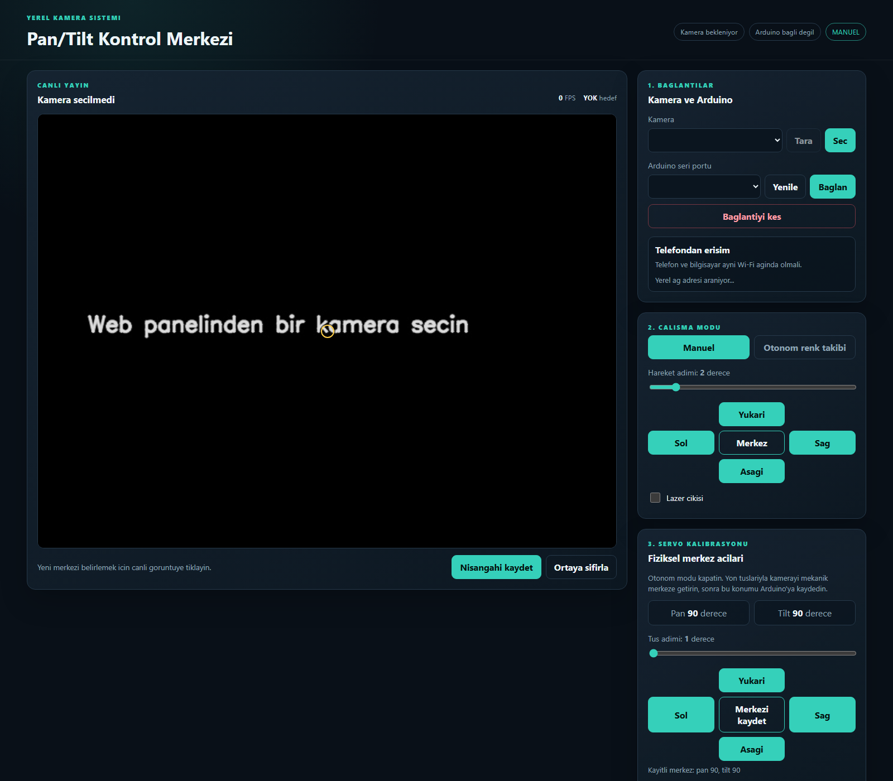
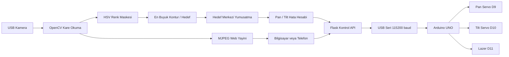
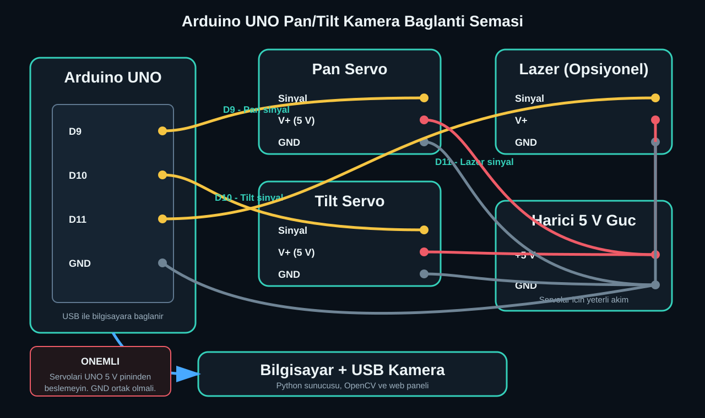

<div align="center">

# Color Track Pan-Tilt Camera

### Arduino UNO, USB kamera ve OpenCV ile web kontrollu otonom renk takip sistemi

[](https://www.python.org/)
[](https://flask.palletsprojects.com/)
[](https://opencv.org/)
[](https://www.arduino.cc/)
[](#testler)

USB kamerayi tarayicida yayinlayan, telefondan veya bilgisayardan manuel kontrol edilen
ve model egitmeden secilen rengi otonom takip eden pan-tilt kamera projesi.

</div>

---

## Web Arayuzu



Web paneli masaustu ve mobil ekranlara uyumludur. Kamera secimi, Arduino baglantisi,
manuel hareket, servo merkez kalibrasyonu, nisangah ayari ve renk takibi tek sayfadan
yonetilir.

## Proje Ne Yapar?

Sistem bir USB kameradan goruntu alir. Python uygulamasi her kareyi OpenCV ile isler ve
Flask uzerinden MJPEG olarak web paneline yayinlar. Manuel modda web arayuzundeki yon
tuslari Arduino'ya seri komut gonderir. Otonom modda secilen HSV renk araligindaki en
buyuk hedef bulunur ve servo mekanizmasi hedefin merkezini kullanicinin belirledigi sari
yuvarlak nisangaha getirmeye calisir.

Bu proje icin:

- YOLO modeli gerekmez.
- Veri seti gerekmez.
- Model egitimi gerekmez.
- Bulut servisi veya internet baglantisi gerekmez.

Her sey bilgisayarda ve yerel agda calisir.

## Temel Ozellikler

| Ozellik | Aciklama |
| --- | --- |
| Canli yayin | USB kamera goruntusu tarayicida MJPEG olarak yayinlanir |
| Kamera secimi | Bilgisayardaki uygun kamera indeksleri taranir |
| Manuel kontrol | Yukari, asagi, sol, sag ve merkez komutlari |
| Otonom takip | HSV renk maskeleme ile hedef takibi |
| Renk profilleri | Kirmizi, yesil, mavi ve sari hazir ayarlari |
| Ozel renk | HSV alt/ust sinirlari elle degistirilebilir |
| Ozel nisangah | Canli goruntuye tiklanarak takip merkezi belirlenir |
| Servo kalibrasyonu | Pan/tilt merkezleri web panelinden ayarlanir |
| Kalici merkez | Servo merkezleri Arduino EEPROM'una kaydedilir |
| Titresim azaltma | Hedef yumusatma, olu bolge ve komut sinirlama |
| Mobil erisim | Ayni Wi-Fi veya telefon hotspotundan kontrol |
| Lazer cikisi | D11 uzerinden opsiyonel lazer kontrolu |

## Sistem Akisi



## Gerekli Malzemeler

### Zorunlu

- Arduino UNO veya UNO uyumlu kart
- USB webcam
- 2 adet servo motor
- Pan-tilt mekanizmasi
- Servolar icin harici 5 V guc kaynagi
- Jumper kablolar
- Arduino USB kablosu
- Windows, Linux veya macOS bilgisayar

### Opsiyonel

- D11 ile kontrol edilebilen lazer modulu
- Servo hareketine uygun rulmanli veya 3D baski mekanizma
- Harici acma/kapama anahtari

## Arduino Pin Semasi



### Pin Tablosu

| Arduino pini | Baglanan bilesen | Not |
| --- | --- | --- |
| `D9` | Pan servo sinyal kablosu | Yatay hareket |
| `D10` | Tilt servo sinyal kablosu | Dikey hareket |
| `D11` | Lazer sinyal girisi | Opsiyonel |
| `GND` | Harici guc kaynagi GND | Ortak toprak zorunlu |
| USB | Bilgisayar | Seri haberlesme ve Arduino beslemesi |

### Servo Kablo Renkleri

Servo markasina gore renkler degisebilir. Genellikle:

| Kablo | Gorev |
| --- | --- |
| Kahverengi veya siyah | GND |
| Kirmizi | +5 V |
| Turuncu, sari veya beyaz | Sinyal |

> [!CAUTION]
> MG995, MG996 veya benzeri yuksek akimli servolari Arduino UNO'nun `5V` pininden
> beslemeyin. Harici ve yeterli akim saglayan 5 V kaynak kullanin.

> [!IMPORTANT]
> Harici guc kaynagi GND, servo GND ve Arduino GND birbirine baglanmalidir. Ortak GND
> yoksa servo sinyalleri guvenilir calismaz.

## Yazilim Gereksinimleri

- Python `3.11` veya daha yeni surum
- Arduino IDE
- Git
- Modern web tarayicisi
- Windows'ta gerekirse CH340 USB-seri surucusu

Python kutuphaneleri:

```text
Flask
NumPy
OpenCV
PySerial
```

## Proje Yapisi

```text
color-track-pan-tilt-camera/
|-- app.py                         # Flask API, kamera ve takip motoru
|-- requirements.txt               # Python bagimliliklari
|-- README.md
|-- arduino/
|   `-- servo_controller/
|       `-- servo_controller.ino   # Arduino servo ve EEPROM yazilimi
|-- docs/
|   |-- web-interface.png          # Web paneli ekran goruntusu
|   `-- wiring-diagram.svg         # Arduino pin semasi
|-- static/
|   |-- app.js                     # Web paneli davranislari
|   `-- style.css                  # Arayuz tasarimi
|-- templates/
|   `-- index.html                 # Ana web sayfasi
`-- tests/
    `-- test_app.py                # Otomatik testler
```

# Sifirdan Kurulum

## 1. Repoyu Klonlama

PowerShell veya terminal:

```powershell
git clone https://github.com/EnesErdogans/color-track-pan-tilt-camera.git
cd color-track-pan-tilt-camera
```

## 2. Python Sanal Ortami

### Windows PowerShell

```powershell
py -m venv .venv
.\.venv\Scripts\Activate.ps1
python -m pip install --upgrade pip
python -m pip install -r requirements.txt
```

PowerShell script calistirmayi engellerse:

```powershell
Set-ExecutionPolicy -Scope CurrentUser RemoteSigned
```

Alternatif olarak ortam aktifleştirmeden dogrudan:

```powershell
.\.venv\Scripts\python.exe -m pip install -r requirements.txt
```

### Linux veya macOS

```bash
python3 -m venv .venv
source .venv/bin/activate
python -m pip install --upgrade pip
python -m pip install -r requirements.txt
```

## 3. Arduino Yazilimini Yukleme

1. Arduino IDE'yi acin.
2. `arduino/servo_controller/servo_controller.ino` dosyasini acin.
3. **Tools > Board** menusu altindan Arduino UNO'yu secin.
4. **Tools > Port** altindan Arduino'nun COM portunu secin.
5. **Upload** dugmesine basin.
6. IDE yuklemenin tamamlandigini bildirene kadar bekleyin.
7. Serial Monitor aciksa kapatin.

Web uygulamasi seri portu kullanacagi icin Arduino IDE Serial Monitor ayni anda acik
olmamalidir.

## 4. Web Sunucusunu Baslatma

Windows:

```powershell
.\.venv\Scripts\python.exe .\app.py
```

Linux/macOS:

```bash
python app.py
```

Terminalde benzer bir cikti gorulur:

```text
Running on http://127.0.0.1:5000
Running on http://192.168.x.x:5000
```

Bilgisayarda acin:

```text
http://127.0.0.1:5000
```

# Web Paneli Kullanim Rehberi

## 1. Kamera Secme

1. **Tara** dugmesine basin.
2. Sistem kamera indekslerini ve Windows kamera backend'lerini dener.
3. Acilir listeden kullanmak istediginiz kamerayi secin.
4. **Sec** dugmesine basin.
5. Canli goruntunun gelmesini bekleyin.

Ilk uygun kamera uygulama acilisinda otomatik secilebilir.

Kamera bulunmuyorsa:

- Windows Kamera uygulamasini kapatin.
- OBS, Discord, Zoom veya tarayicida kamerayi kullanan sekmeleri kapatin.
- USB kamerayi cikartip yeniden takin.
- Panelde tekrar **Tara** dugmesine basin.

## 2. Arduino'ya Baglanma

1. Arduino'yu USB ile bilgisayara baglayin.
2. Port listesinin yanindaki **Yenile** dugmesine basin.
3. Genellikle `COM3`, `COM8`, `COM9` gibi gorunen Arduino portunu secin.
4. **Baglan** dugmesine basin.
5. Ust durum cubugunda portun bagli oldugunu kontrol edin.

CH340 tabanli klon kartlarda aciklama `USB-SERIAL CH340` olabilir.

## 3. Manuel Kontrol

**Manuel** modunu secin.

- **Yukari:** Tilt eksenini yukari hareket ettirir.
- **Asagi:** Tilt eksenini asagi hareket ettirir.
- **Sol:** Pan eksenini sola hareket ettirir.
- **Sag:** Pan eksenini saga hareket ettirir.
- **Merkez:** Arduino EEPROM'una kaydedilmis servo merkezine doner.

`Hareket adimi` tek tus basiminda kac derece hareket edilecegini belirler.

- Hassas ayar: `1-2 derece`
- Normal hareket: `3-5 derece`
- Hizli konumlama: `6-10 derece`

## 4. Servo Merkez Kalibrasyonu

Servo mekanizmasi fiziksel olarak `90 / 90` acisinda tam ortaya bakmayabilir. Kalibrasyon
bolumu gercek mekanik merkezi belirler.

1. Sistemi **Manuel** moda alin.
2. `Tus adimi` degerini `1 derece` yapin.
3. Kalibrasyon bolumundeki yon tuslariyla kamerayi istediginiz fiziksel merkeze getirin.
4. Paneldeki pan ve tilt derece degerlerini kontrol edin.
5. **Merkezi kaydet** dugmesine basin.

Kayit Arduino EEPROM'una yazilir:

- Arduino kapaninca silinmez.
- Uygulama yeniden acilinca okunur.
- **Merkez** dugmesi bu konuma doner.
- Arduino ilk acildiginda bu konumu kullanir.

Mekanik sinirlar:

| Eksen | Izin verilen aralik |
| --- | --- |
| Pan | `10-170 derece` |
| Tilt | `20-160 derece` |

Servo zorlanirsa veya mekanizmaya carpiyorsa hemen ters yone hareket ettirin ve fiziksel
sinirlara uygun bir merkez secin.

## 5. Nisangah Ayarlama

Sari yuvarlak, otonom sistemin hedefi getirmeye calistigi noktadir.

1. Canli goruntu uzerinde istediginiz noktaya tiklayin.
2. Sari yuvarlak tikladiginiz yere gelir.
3. **Nisangahi kaydet** dugmesine basin.

Nisangahi tekrar goruntunun tam ortasina almak icin **Ortaya sifirla** dugmesini kullanin.

Nisangah ayari bilgisayarda `data/settings.json` dosyasinda tutulur. Bu dosya kullaniciya
ozeldir ve GitHub'a gonderilmez.

## 6. Renk Secme

Otonom modu actiktan sonra **HSV hedef ayarlari** paneli gorunur.

Hazir profiller:

- **Kirmizi**
- **Yesil**
- **Mavi**
- **Sari**

Bir profile basin ve ardindan **Ayarlari uygula** dugmesine basin.

### Ozel Renk Ayarlama

Hazir profiller yeterli degilse HSV degerlerini elle ayarlayin:

| Alan | Aralik | Gorev |
| --- | --- | --- |
| H alt / H ust | `0-179` | Rengin tonu |
| S alt / S ust | `0-255` | Rengin doygunlugu |
| V alt / V ust | `0-255` | Rengin parlakligi |

Pratik ayarlama:

1. Once hedefe en yakin hazir rengi secin.
2. Hedef bulunmuyorsa `H alt` degerini azaltin veya `H ust` degerini artirin.
3. Arka plan da algilaniyorsa `S alt` degerini artirin.
4. Karanlik alanlar algilaniyorsa `V alt` degerini artirin.
5. Her degisiklikten sonra **Ayarlari uygula** dugmesine basin.

Kirmizi renk HSV halkasinin iki ucunda bulunur. Bu nedenle kirmizi profilinde `H alt`,
`H ust` degerinden buyuk olabilir. Uygulama `170-10` gibi sarmalanan araliklari destekler.

## 7. Takip Hassasiyeti

### Minimum hedef alani

Hedef sayilacak en kucuk renk bolgesini belirler.

- Yanlis kucuk lekeler algilaniyorsa artirin.
- Uzak veya kucuk hedef algilanmiyorsa azaltin.

### Yatay ve dikey olu bolge

Hedef nisangaha yeterince yaklastiginda servonun durdugu gorunmez tolerans alanidir.
Ekranda kare olarak cizilmez.

- Sistem titriyorsa artirin.
- Daha hassas merkezleme gerekiyorsa azaltin.

### Takip kazanci

Piksel hatasinin servo hareketine etkisini belirler.

- Sistem yavas kaliyor: biraz artirin.
- Sistem hedefi geciyor veya saliniyor: azaltin.

### Maksimum hareket

Tek otonom komutta izin verilen en buyuk derece degisimidir.

- Yumusan hareket: `1-3`
- Daha hizli takip: `4-6`

## 8. Otonom Modu Baslatma

1. Kamera ve Arduino'nun bagli oldugunu kontrol edin.
2. Nisangahi ayarlayin.
3. Hedef renk profilini secin.
4. Takip ayarlarini uygulayin.
5. **Otonom renk takibi** modunu acin.
6. Hedefi kamera goruntusune getirin.

Sistem:

1. HSV maskesi olusturur.
2. Gurultuyu temizler.
3. En buyuk uygun konturu hedef secir.
4. Hedef merkezini yumusatir.
5. Nisangah ile hedef arasindaki hatayi hesaplar.
6. Arduino'ya kucuk pan/tilt komutlari gonderir.

Manuel moda dondugunuzda otonom komut uretimi durur.

## 9. Lazer Kontrolu

Lazer modulu bagliysa manuel paneldeki **Lazer cikisi** anahtari kullanilir.

> [!WARNING]
> Lazeri insanlara, hayvanlara, gozlere, araclara veya yansitici yuzeylere yoneltmeyin.

# Telefondan Erisim

Telefon ve bilgisayar:

- Ayni Wi-Fi aginda olabilir.
- Telefon hotspot acip bilgisayar bu hotspota baglanabilir.

Adimlar:

1. Bilgisayarda sunucuyu calistirin.
2. Web panelindeki **Telefondan erisim** kutusunu bulun.
3. Oradaki `http://IP:5000` adresini telefonda Chrome veya Safari'ye yazin.
4. `https://` degil `http://` kullanin.

Ornek:

```text
http://192.168.1.25:5000
```

### Windows Guvenlik Duvari

Telefon baglanamiyorsa yonetici PowerShell terminalinde:

```powershell
New-NetFirewallRule `
  -DisplayName "Color Track Camera 5000" `
  -Direction Inbound `
  -Action Allow `
  -Protocol TCP `
  -LocalPort 5000 `
  -RemoteAddress LocalSubnet
```

Kontrol listesi:

- Flask terminalde calisiyor mu?
- Bilgisayarda `http://127.0.0.1:5000` aciliyor mu?
- Telefon ve bilgisayar ayni agda mi?
- Paneldeki guncel IP kullaniliyor mu?
- Telefon mobil veri yerine hotspot/Wi-Fi agini kullaniyor mu?
- Hotspot istemci izolasyonu uyguluyor mu?

# Teknik Ayrintilar

## Renk Takip Algoritmasi

1. Kamera karesi BGR'dan HSV'ye donusturulur.
2. HSV alt/ust sinirlariyla ikili maske olusturulur.
3. Morfolojik acma ve kapama ile gurultu temizlenir.
4. Konturlar bulunur.
5. Minimum alani gecen en buyuk kontur hedef secilir.
6. Hedef merkezi dusuk geciren filtreyle yumusatilir.
7. Nisangah hatasi olu bolge ve kazanc ile servo komutuna donusturulur.
8. Komut hizi ve maksimum adim sinirlanir.

## Seri Protokol

Python ve Arduino `115200 baud`, satir tabanli ASCII protokol kullanir.

| Komut | Aciklama | Ornek |
| --- | --- | --- |
| `M,pan,tilt` | Goreli hareket | `M,2,-1` |
| `C` | Kalibre edilmis merkeze don | `C` |
| `L,0/1` | Lazer kapat/ac | `L,1` |
| `P,pan,tilt` | Mutlak kalibrasyon konumunu onizle | `P,88,94` |
| `K,pan,tilt` | Merkezi EEPROM'a kaydet | `K,88,94` |
| `Q` | Kayitli kalibrasyonu sorgula | `Q` |

Arduino cevaplari:

```text
READY,PAN_TILT
CAL,90,90
OK,MOVE
OK,CENTER
OK,PREVIEW
OK,CALIBRATION
OK,LASER
ERR,COMMAND
```

## API Uclari

| Yontem | Yol | Gorev |
| --- | --- | --- |
| `GET` | `/api/status` | Sistem durumu |
| `GET` | `/api/cameras` | Kamera listesi |
| `POST` | `/api/camera` | Kamera secimi |
| `GET` | `/api/serial/ports` | Seri port listesi |
| `POST` | `/api/serial/connect` | Arduino baglantisi |
| `POST` | `/api/move` | Manuel hareket |
| `POST` | `/api/center` | Servo merkezleme |
| `POST` | `/api/calibration/preview` | Kalibrasyon onizleme |
| `POST` | `/api/calibration/save` | EEPROM merkez kaydi |
| `POST` | `/api/aim-center` | Nisangah kaydi |
| `POST` | `/api/tracking` | HSV takip ayarlari |

# Testler

Tum testleri calistirin:

```powershell
.\.venv\Scripts\python.exe -m unittest discover -s tests -v
```

Testler:

- Flask ana sayfasi
- Durum API'si
- Seri baglanti zorunlulugu
- HSV deger sinirlari
- Sentetik kirmizi hedef algilama
- Nisangah koordinat dogrulamasi
- Servo kalibrasyon API'leri
- Yerel ag adres bilgisi

# Sorun Giderme

## `ModuleNotFoundError: No module named 'cv2'`

Paket adi `cv2` degildir:

```powershell
.\.venv\Scripts\python.exe -m pip install -r requirements.txt
```

## Kamera goruntusu gelmiyor

- Kamerayi kullanan diger programlari kapatin.
- Kamera listesini yeniden tarayin.
- USB portunu degistirin.
- Windows kamera izinlerini kontrol edin.

## Servo hareket etmiyor

- Arduino sketch'inin guncel oldugunu kontrol edin.
- Dogru COM portuna baglanin.
- Serial Monitor'u kapatin.
- Servo gucunu ve ortak GND'yi kontrol edin.

## Servo titriyor

- Harici guc kaynaginin akimini kontrol edin.
- Olu bolgeyi buyutun.
- Takip kazancini azaltin.
- Maksimum hareketi azaltin.
- Minimum hedef alanini artirin.
- Kamera sabitlemesini iyilestirin.

## Servo ters yone gidiyor

Arduino dosyasinda:

```cpp
const int PAN_DIRECTION = -1;
const int TILT_DIRECTION = 1;
```

Ters giden eksenin degerini `1` ile `-1` arasinda degistirin ve sketch'i yeniden
yukleyin.

## Arduino kalibrasyon cevabi vermiyor

Arduino'da eski sketch yuklu olabilir. Repodaki guncel
`arduino/servo_controller/servo_controller.ino` dosyasini yeniden yukleyin.

## Telefon baglanmiyor

- `http://` kullandiginizi kontrol edin.
- Bilgisayarin guncel IP adresini kullanin.
- TCP `5000` guvenlik duvari kuralini ekleyin.
- Telefon ve bilgisayari ayni ağa baglayin.

# Guvenlik

- Flask gelistirme sunucusunu dogrudan internete acmayin.
- Yalnizca guvendiginiz yerel aglarda kullanin.
- Servo mekanizmasinin fiziksel sinirlarini zorlamayin.
- Yuksek akimli servolari Arduino 5 V pininden beslemeyin.
- Lazeri insanlara veya hayvanlara yoneltmeyin.
- Hareketli mekanizmada parmak sikisma riskine dikkat edin.

# Katkida Bulunma

Hata bildirimi ve gelistirme onerileri icin GitHub Issues kullanilabilir. Pull request
acmadan once testleri calistirin ve degisikligin donanim davranisina etkisini aciklayin.

# Lisans

Bu repoya henuz bir acik kaynak lisansi eklenmemistir. Lisans eklenene kadar tum haklar
repo sahibine aittir.

---

<div align="center">

Developed by [EnesErdogans](https://github.com/EnesErdogans)

</div>
